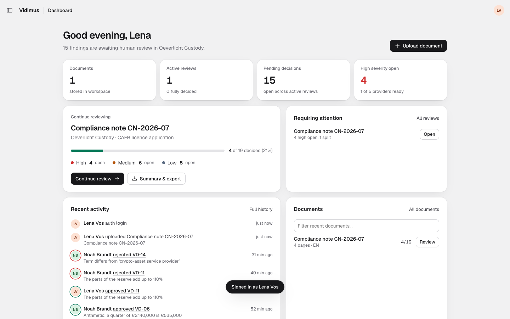
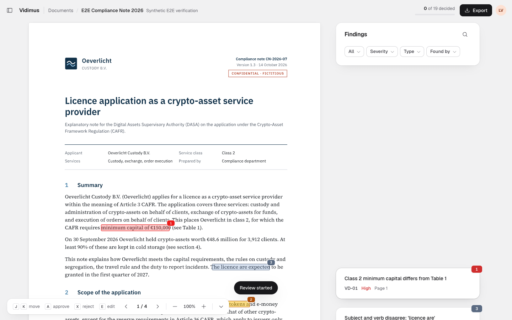
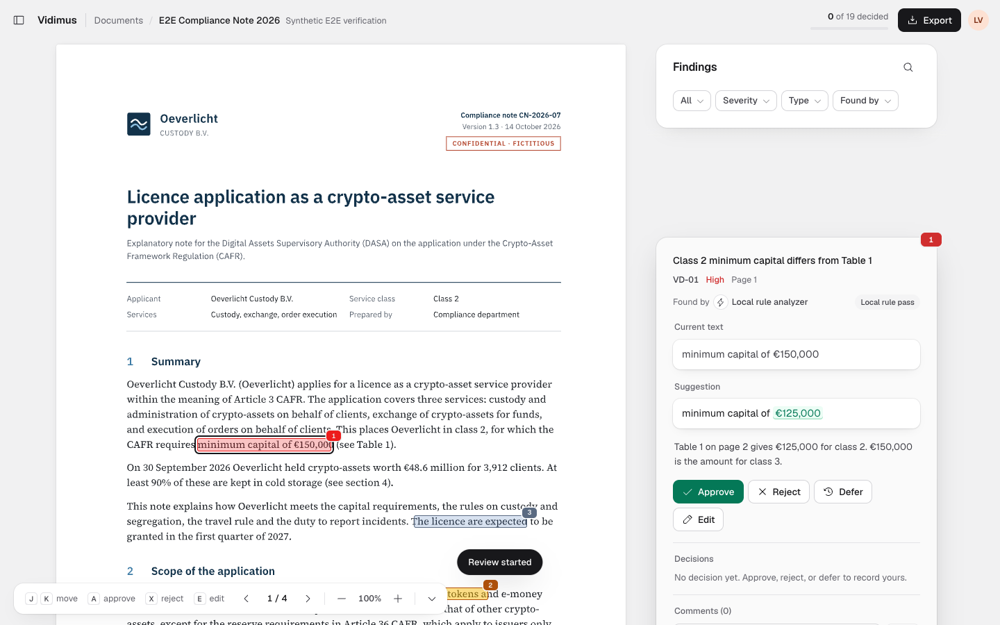
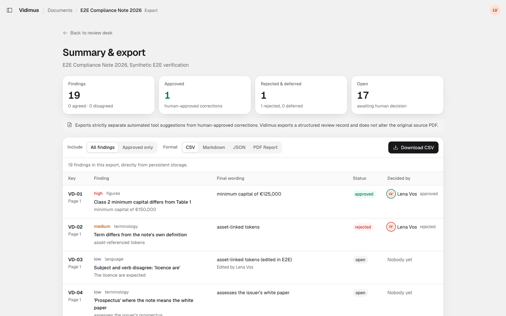
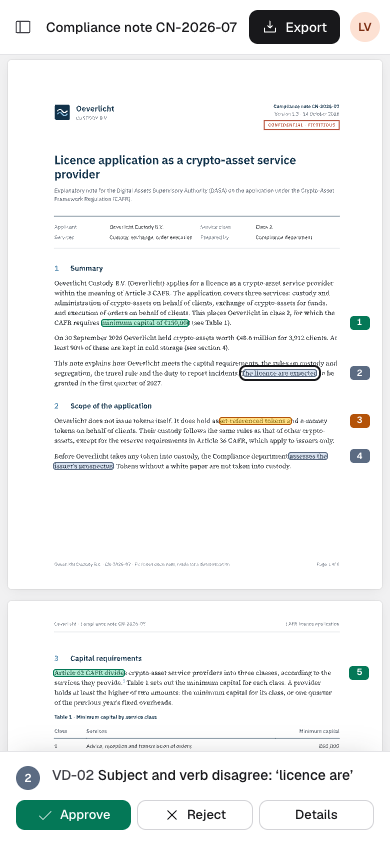

# Vidimus

A full-stack review desk for regulatory, legal, corporate, and translated documents. Connected models and language tools analyze uploaded PDFs and flag potential issues anchored to exact passages; human reviewers compare proposals, approve, edit, reject, defer, or comment on each finding, and export an auditable decision record.

**Core principle: Machines analyze. Humans decide.** Automated review surfaces candidate findings for qualified human judgment and does not certify legal or regulatory compliance.



## What Vidimus does

- **Real PDF ingestion and exact passage anchoring.** Uploaded PDFs are validated (`%PDF-` signature, size limit, safe private storage) and extracted with PDF.js. Every finding is matched strictly against its page text: unique matches receive page-relative highlight coordinates; ambiguous or missing quotes are flagged explicitly instead of guessing. Scanned PDFs with no extractable text are detected and marked `OCR required`.
- **Paper review desk.** Preserves Vidimus's cool-neutral Paper interface: translucent severity-tinted PDF highlights with numbered corner badges, Google Docs-style floating finding cards level with their text on desktop, green word-level diffs for suggested wording, provider disagreement callouts, reviewer comments, full decision history, and keyboard shortcuts (`j`/`k`, `a`, `x`, `e`, `/`, `Esc`).
- **Multi-provider analysis engine.** Supports Anthropic Claude (`@anthropic-ai/sdk`), OpenAI (`openai`), Google Gemini (`@google/genai`), LanguageTool (local or configured HTTP endpoint), and a built-in **local deterministic rule analyzer** for offline development and testing. Provider credentials live strictly in server environment variables and are never exposed to the browser.
- **Translation and localization reviews.** Upload a source PDF alongside its translated PDF to compare passages side by side, detect untranslated text or numerical discrepancies, and enforce reusable terminology glossaries (preferred and forbidden terms).
- **Dashboard, reviews, and exports.** Live workspace metrics, reviews requiring attention, document versioning, audit history, and real server-generated exports in **CSV**, **Markdown**, **JSON**, and **PDF Report** formats that separate unapproved tool suggestions from human-approved corrections.
- **Mobile layout.** Full-width PDF with right-margin badges, a hugging bottom quick-action bar, and a full-page Findings screen with a `Document` back control.

| | |
|---|---|
|  |  |
|  |  |

## Stack

- **Frontend (`web/`):** React 19, TypeScript, Vite 6, React Router 7, PDF.js (`pdfjs-dist`), Phosphor icon sprite, Paper CSS tokens (light and dark themes).
- **Backend (`server/`):** Node 22, TypeScript, Fastify 5, SQLite via Node built-in `node:sqlite` (WAL mode, foreign keys, versioned migrations), `pdfjs-dist` extraction, `pdf-lib` PDF report generation.
- **Shared (`packages/shared/`):** TypeScript domain models, Zod validation schemas, text folding, word diffing, and multi-provider finding consolidation.
- **Testing:** Vitest (unit, integration, RBAC, security, provider fixtures) and Playwright + axe-core (full-stack desktop & mobile E2E + accessibility).

See [ARCHITECTURE.md](ARCHITECTURE.md) for the full system architecture and data model.

## Quick start

Requires **Node.js 22+** and **npm 10+**.

```bash
npm install
npm run build
npm start
# Open http://127.0.0.1:8777
```

For local development with hot reload (Fastify on `:8777`, Vite on `:5173`):

```bash
cp .env.example .env
npm run dev
# Open http://localhost:5173
```

### Development seed accounts

When `VIDIMUS_SEED_DEMO=true` (enabled by default in local development, disable in production), Vidimus seeds the synthetic **Oeverlicht Custody** workspace with the invented 4-page compliance note (`lab/sample/note.pdf`) and four accounts (password: `vidimus-dev-password`):

| Account | Role | Capabilities |
|---|---|---|
| `lena@example.com` | `admin` | Full access, workspace & provider settings |
| `sam@example.com` | `reviewer` | Upload, configure reviews, decide, edit, comment |
| `noah@example.com` | `reviewer` | Upload, configure reviews, decide, edit, comment |
| `auditor@example.com` | `viewer` | Read-only access to documents, reviews, exports |

You can also register new accounts with isolated private workspaces from the Sign in screen.

## Environment variables & provider setup

Copy `.env.example` to `.env`. Never commit `.env` or real API keys.

| Variable | Default | Purpose |
|---|---|---|
| `PORT` / `HOST` | `8777` / `127.0.0.1` | Server bind address |
| `VIDIMUS_DB_PATH` | `./data/vidimus.sqlite` | SQLite database file |
| `VIDIMUS_UPLOADS_DIR` | `./data/uploads` | Private PDF storage directory |
| `SESSION_SECRET` | dev fallback | Cookie signing secret (set 32+ random chars in prod) |
| `COOKIE_SECURE` | `false` | Set `true` behind HTTPS |
| `MAX_UPLOAD_MB` | `25` | Maximum uploaded PDF size |
| `VIDIMUS_SEED_DEMO` | `true` | Seed synthetic dev workspace when DB is empty |
| `ANTHROPIC_API_KEY` | unset | Enables live Anthropic Claude API adapter |
| `OPENAI_API_KEY` | unset | Enables live OpenAI API adapter |
| `GEMINI_API_KEY` | unset | Enables live Google Gemini API adapter |
| `LANGUAGETOOL_URL` | unset | Enables live LanguageTool HTTP adapter (e.g. `http://127.0.0.1:8081/v2/check`) |

### Live vs local test adapters

- **Live API providers** (`anthropic`, `openai`, `gemini`, `languagetool`) activate automatically when their server environment variable is present. Document text is only transmitted to external APIs when that provider is explicitly selected on the review configuration screen.
- **Local deterministic rule analyzer (`deterministic`)** runs locally with zero external calls and is labeled `Local rule analyzer` in the UI and provenance records. It runs verifiable checks for figures, calendar dates, repeated words, glossary violations, and source-to-target parity on uploaded PDFs.

## Database & migrations

Migrations live in `server/src/db/migrations.ts` and run automatically on server startup, or manually via:

```bash
npm run migrate
```

## Testing

```bash
# Typecheck and production build
npm run build

# Unit, integration, security, RBAC, and provider-fixture tests
npm test

# Playwright full-stack E2E, responsive, and WCAG accessibility tests
npm run test:e2e
```

## Security considerations

- Passwords are hashed with per-user salted `scrypt` and verified in constant time.
- Sessions use opaque random tokens stored as SHA-256 hashes in SQLite, issued via `HttpOnly; SameSite=Lax` cookies.
- Mutating `/api/*` requests require a matching per-session `X-CSRF-Token` header.
- Role-based access control (`admin`, `reviewer`, `viewer`) and workspace ownership are enforced server-side on every route, including PDF file streaming.
- Uploaded files are verified by `%PDF-` signature, size limits, and UUID storage paths to prevent path traversal.
- External model prompts isolate uploaded document text inside `<untrusted_document>` tags and validate all outputs with Zod before persistence.

## Preserved static lab & translation pipeline

The original static Paper demonstration (`lab/v1/index.html`) and the Python site-scraping translation pipeline (`pipeline/`, `desk/`, `out/`) remain preserved in the repository:

```bash
./start.command                         # Static lab at http://localhost:8777/lab/v1/
python3 -m unittest discover -s tests   # Original Python lab/pipeline tests (requires requirements.txt)
```

## Known limitations & roadmap

- **OCR for scanned PDFs:** Scanned image-only PDFs are detected and blocked with a clear `OCR required` state; an automated OCR pipeline stage (e.g. Tesseract or cloud OCR opt-in) is planned next.
- **Live external provider verification:** All four external adapters (`anthropic`, `openai`, `gemini`, `languagetool`) are implemented and tested via schema/orchestration fixtures; live end-to-end calls require configuring API credentials in `.env`.
- **Single-node SQLite:** Suitable for local-first and small-team deployments; migrating the repository layer to PostgreSQL and Redis/BullMQ would support multi-node horizontal scaling.
- **Export format:** Exports generate structured review records (CSV, Markdown, JSON, PDF report) and intentionally do not overwrite or alter the original uploaded PDF.

## Commit convention

Conventional Commits: `type(scope): imperative lowercase summary` (max 72 characters, no trailing period).

## License

All rights reserved. Shared for review only.
