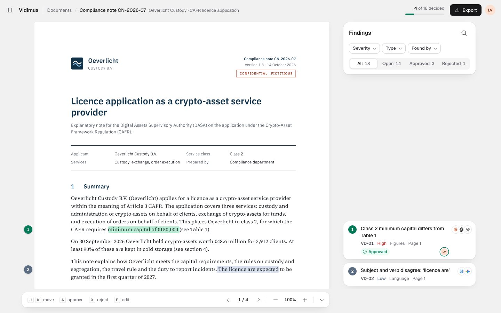
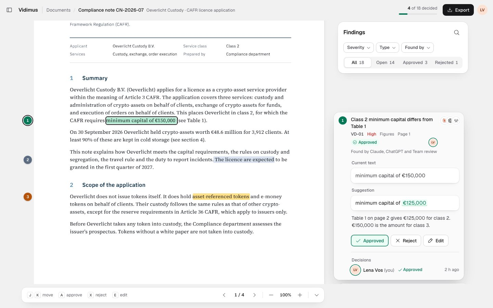
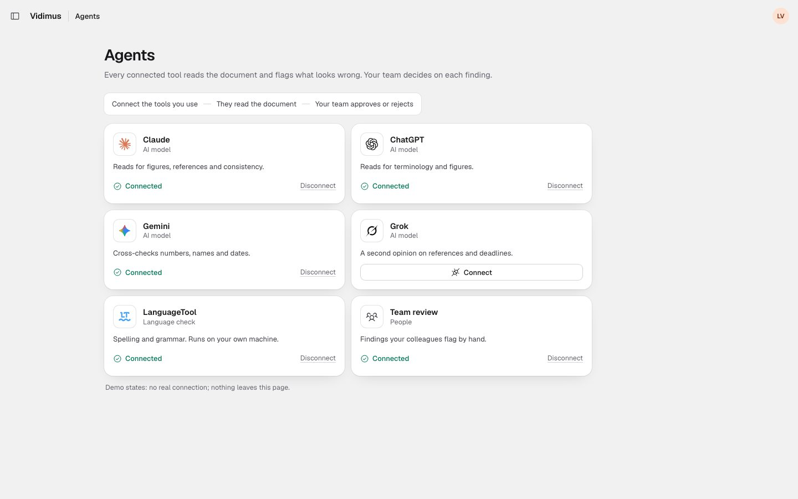
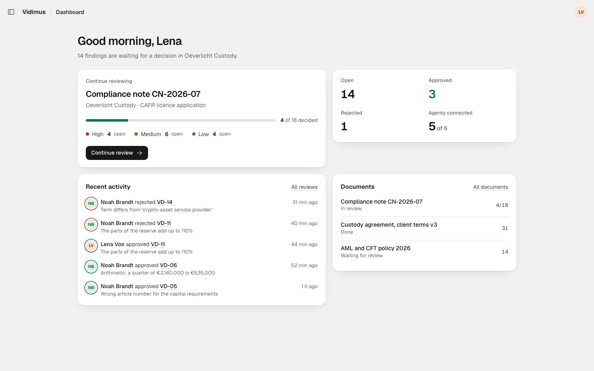
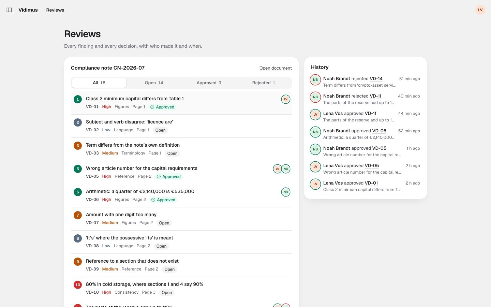
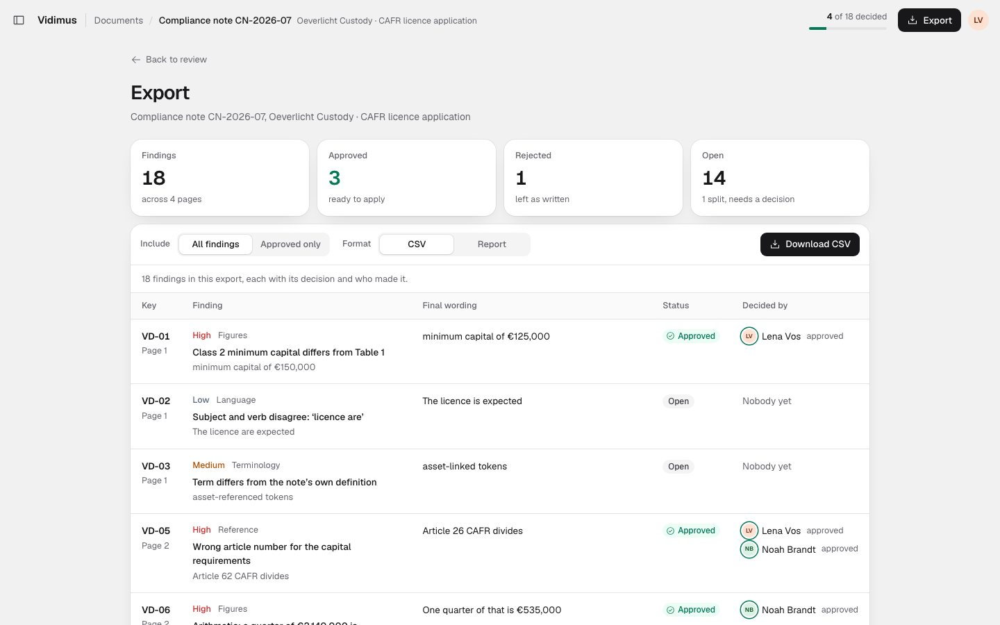
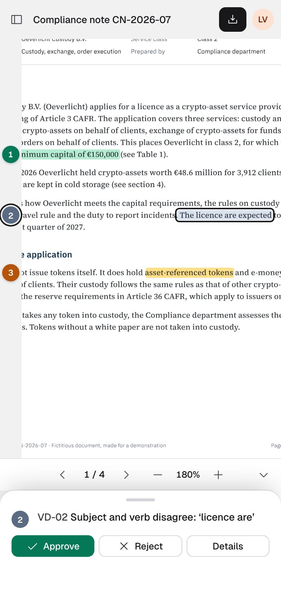

# Vidimus

A review desk for regulatory documents. AI models and language tools read the document and flag what looks wrong; the team reads each finding beside the text it is about, and approves, edits or rejects it. Shown here on an invented four-page compliance note with 19 mistakes put in on purpose.

> A clean snapshot of a private repository, shared for review. Every name, figure and document in it is invented.



## What the desk does

- **One document, mistakes marked in place.** The desk renders the PDF itself with PDF.js, finds each finding's quoted text in it and tints that text. Numbered markers sit in a gutter beside the page, never on the text. Every finding has a key (`VD-01` …) the team can refer to.
- **Findings float beside the page, like comments in Google Docs.** Each finding is a card level with its text that scrolls with the document. Folded, it shows its title, severity and who decided; opened, it shows the current text, the suggestion (the new wording, changes in green), any alternative wording from another tool, and the decisions. The cards around it move aside.
- **Filters** by severity, type and the tool that found it, with counts, plus All / Open / Approved / Rejected and a search. They stay pinned at the top of the findings.
- **Team decisions.** Approve, reject or edit a suggestion; each decision records who made it and when, so one finding can be approved by one person and rejected by another.
- **Connect your tools** (Claude, ChatGPT, Gemini, Grok, LanguageTool and team review) as **demo states**: connecting is simulated, no key is asked for, nothing is called.
- **Dashboard** (progress, open findings by severity, recent decisions), **Reviews** (every finding and the full history of who approved, rejected or edited what) and **Documents**.
- **Export** of every finding, or only the approved ones, with its decision and who made it, as CSV or as a Markdown report.
- **Keyboard:** `j`/`k` next and previous, `a` approve, `x` reject, `e` edit, `/` search, `Esc` folds the open card. A bar under the page shows them with the page and zoom controls; it hides behind a small arrow.
- **Phone:** the page at reading size, the findings in a sheet that slides up, approve or reject from its peek.

| | |
|---|---|
|  |  |
|  |  |
|  |  |

**Sample states only.** The sign-in (three demo accounts), the connected tools and every decision are kept in the browser's local storage. Nothing leaves the page. The logos name the tools and remain their owners' trademarks; sources and licences are in `lab/assets/NOTICE.md`.

## Run it

```bash
./start.command                     # opens http://localhost:8777/lab/v1/
```

or by hand:

```bash
python3 -m http.server 8777 --bind 127.0.0.1
# http://localhost:8777/lab/v1/   (?as=sam opens it signed in as a demo account)
```

The desk is one static page with its data inlined, committed in `lab/v1/index.html`. To rebuild it:

```bash
python3 lab/sample/make_pdf.py      # note.html -> lab/sample/note.pdf (needs Chrome and network for the fonts)
python3 lab/build.py                # checks every quote against the PDF, then builds lab/v1
```

The build refuses a finding whose quoted text it cannot find exactly once on its page, so a mark can never land on the wrong sentence.

## Under the desk: the translation pipeline

Vidimus started as a desk for translated web pages: a French site with Dutch and English versions. That pipeline is still here and feeds the first desk (`out/`).

- **Aligns the languages.** A scraper reads every page of the site in each language and cuts it into text blocks by their place in the page, so French block 8 and Dutch block 8 are always the same sentence. It reports any page whose block counts differ between languages.
- **Runs the checks.** Three readers, each its own script, each writing JSON:
  - **LanguageTool** on every block of the translation (spelling, grammar, style), plus its language detection, which catches French left in a Dutch or English page.
  - **The reviewer's findings**, a plain list with one full replacement per block. Before a finding reaches the desk the script checks that the block still says what the finding quotes, that it is the only finding on that block, and whether the mistake is still in the translator's PDF.
  - **An external QA report** in plain text, parsed and matched to its block by the text it quotes, not by the number it gives (reports are often written against an older export).
- **Merges them into one card per block**, with the most urgent severity of the readers and every proposed wording as a one-click variant.
- **The first desk** shows the source and the translation side by side, PDFs in panes that scroll together, and hands off every approved correction as text or Markdown. Its interface is in Dutch, for a Dutch-speaking reviewer.

| | |
|---|---|
|  |  |

```bash
python3 -m venv .venv && . .venv/bin/activate
pip install -r requirements.txt
languagetool-server --port 8081 &      # local LanguageTool
./run.sh                               # sample site -> scrape -> checks -> out/review-nl.html, out/review-en.html
# http://localhost:8777/out/review-nl.html
```

Settings, all optional:

| | |
|---|---|
| `VIDIMUS_PROJECT` | another project file instead of `project.json` (site address, pages, languages, vocabulary) |
| `VIDIMUS_AUTH` | `user:password` for a site behind basic auth; never stored in the repository |
| `VIDIMUS_CHROME` | path to the browser that prints the PDFs |
| `LT_SERVER`, `LT_DELAY` | another LanguageTool server, and seconds between calls for a rate-limited one |

The sample in `out/` was checked against LanguageTool's public API (`LT_SERVER=https://api.languagetool.org/v2/check`, `LT_DELAY=3.2`), since the text is invented.

## Why it's built this way

- **Machines flag, a person decides.** Every tool only proposes. Nothing counts until someone approves it, and the export is exactly what was approved, with who approved it.
- **A finding can't land on the wrong sentence.** Every finding carries the text it is about; the build and the scripts stop rather than guess.
- **The finding sits next to its text.** Reading the page and deciding on its mistakes happen in one place, the way people already comment on documents.
- **Private by default.** LanguageTool runs as a local server; the desk is a static page with no backend.
- **No build step to open it.** One HTML file with its data inlined: it opens from any local web server and can be archived with the project.

## Stack

- **JavaScript, HTML and CSS** for the desks: no framework, PDF.js 4.6.82 (Mozilla, Apache-2.0) vendored in `desk/vendor/`, Phosphor icons (MIT).
- **Python 3** for the build and the pipeline: pypdf for reading PDFs, Beautiful Soup for scraping, the standard library for the rest.
- **LanguageTool** (Java, run as a local HTTP server) for the language checks; **headless Chromium** to print PDFs.

## Tests

```bash
python3 -m unittest discover -s tests
```

For the desk: every planted quote found once on its page, the build refusing a finding it cannot place, every icon present in the sprite, and the built page up to date. For the pipeline: block extraction, the QA report parser, the PDF match and LanguageTool's auto-fix. The pipeline scripts also assert their own invariants on every run.

## License

All rights reserved — shared for review only.
