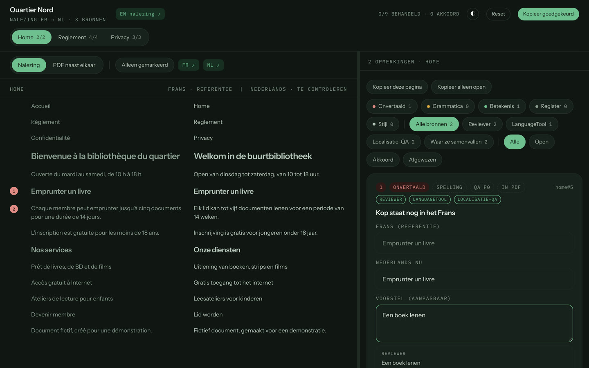
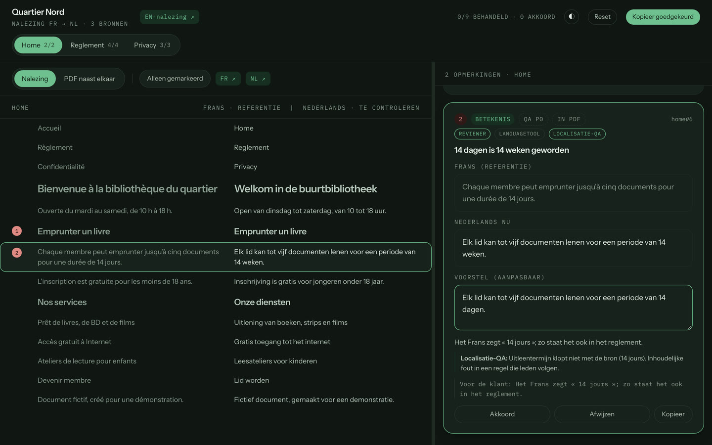
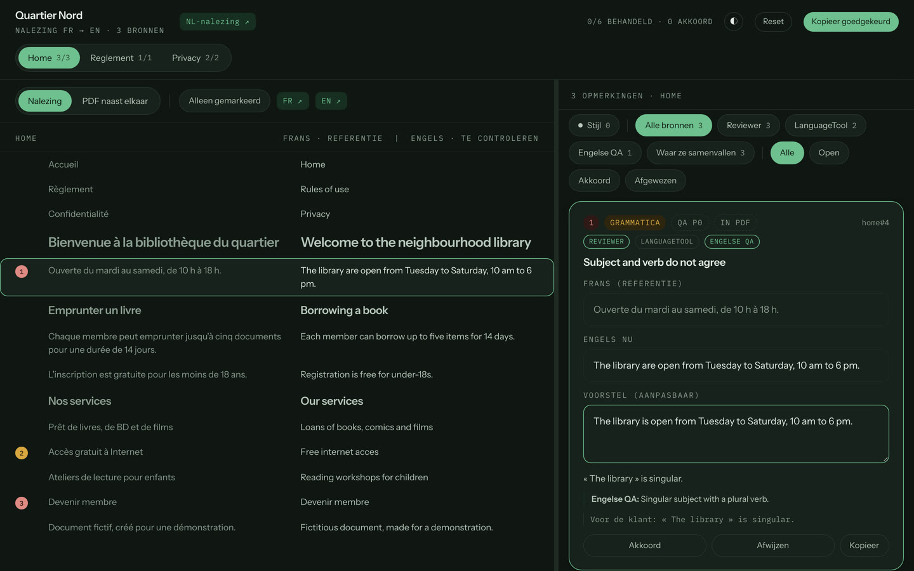
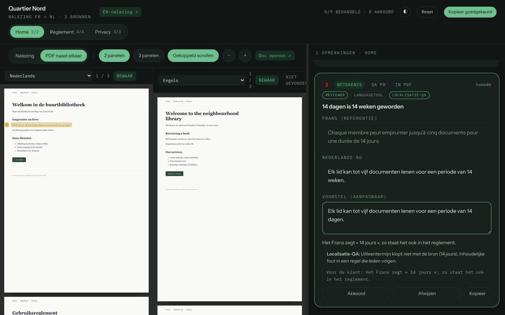

# Vidimus

A review desk for translated regulatory text: automated checks flag what looks wrong in each translation, block by block, and a person reads each card and signs it off or rejects it. Built for a French website with Dutch and English versions; shown here on an invented three-page sample.

> A clean snapshot of a private repository, shared for review.



## What it does

- **Aligns the languages.** A scraper reads every page of the site in each language and cuts it into text blocks by their place in the page, so French block 8 and Dutch block 8 are always the same sentence. It reports any page whose block counts differ between languages.
- **Runs the checks.** Three readers, each its own script, each writing JSON:
  - **LanguageTool** on every block of the translation (spelling, grammar, style), plus its language detection, which catches French left in a Dutch or English page.
  - **The reviewer's findings**, a plain list with one full replacement per block. Before a finding reaches the desk the script checks that the block still says what the finding quotes, that it is the only finding on that block, and whether the mistake is still in the translator's PDF.
  - **An external QA report** in plain text, parsed and matched to its block by the text it quotes, not by the number it gives (reports are often written against an older export).
- **Merges them into one card per block**, with the most urgent severity of the readers and every proposed wording as a one-click variant.
- **The desk** is one self-contained HTML page: the source on the left, the translation on the right, a coloured dot in the margin for every card. Each proposal is editable; *Akkoord* shows the corrected text in place, so you read the page as it will become. Keyboard: `j`/`k` next/previous, `a` approve, `x` reject. Verdicts are kept in the browser.
- **PDFs side by side.** The desk renders the PDFs itself with PDF.js (not in an iframe), so two or three panes scroll together and jump to the page you pick.
- **Hand-off.** *Kopieer goedgekeurd* puts every approved correction on the clipboard, grouped by page, with a reason and a short note per card, ready for the shared document; or as a Markdown file.

The desk's interface is in Dutch: it was built for a Dutch-speaking reviewer.

| | |
|---|---|
|  |  |
|  | |

The screenshots show the invented sample in `sample/`: a fictitious neighbourhood library's home page, rules of use and privacy notice, with mistakes put in the translations on purpose.

## Why it's built this way

- **The source of truth is the live page, not a copy.** Translators and QA work from exports; the scraper reads what readers actually see, so a block missing from an export (a dropdown option, a form label) still gets checked.
- **A finding can't land on the wrong sentence.** Block numbers shift when a page changes. Every finding carries the text it is about, and the scripts stop rather than guess.
- **Machines flag, a person decides.** Every reader only proposes. Nothing is applied until someone approves the card, and what gets copied is exactly what was approved.
- **Private by default.** LanguageTool runs as a local server; no text leaves the machine unless you point `LT_SERVER` elsewhere. The desk is a static page with no backend.
- **No build step for the desk.** One HTML file with its data inlined: it opens from any local web server and can be archived with the project.

## Stack

- **Python 3** for the pipeline: Beautiful Soup (with lxml, or Python's own parser) for scraping, pypdf for reading and assembling PDFs, the standard library for the rest.
- **JavaScript, HTML and CSS** for the desk: one page, no framework, PDF.js 4.6.82 (Mozilla, Apache-2.0) vendored in `desk/vendor/`.
- **LanguageTool** (Java, run as a local HTTP server) for the language checks.
- **Headless Chromium** (Chrome or chrome-headless-shell) to print each language to PDF.
- A shell script to run it all.

## Run it on the sample

Requirements: Python 3.10+, a Chromium-based browser, LanguageTool (`brew install languagetool`).

```bash
python3 -m venv .venv && . .venv/bin/activate
pip install -r requirements.txt
languagetool-server --port 8081 &      # local LanguageTool
./run.sh                               # sample site -> scrape -> checks -> out/review-nl.html, out/review-en.html
./start.command                        # opens the desk at http://localhost:8777/out/review-nl.html
```

The built sample is committed in `out/`, so `./start.command` alone shows the desk.

Settings, all optional:

| | |
|---|---|
| `VIDIMUS_PROJECT` | another project file instead of `project.json` (site address, pages, languages, vocabulary) |
| `VIDIMUS_AUTH` | `user:password` for a site behind basic auth; never stored in the repository |
| `VIDIMUS_CHROME` | path to the browser that prints the PDFs |
| `LT_SERVER`, `LT_DELAY` | another LanguageTool server, and seconds between calls for a rate-limited one |

The sample in `out/` was checked against LanguageTool's public API (`LT_SERVER=https://api.languagetool.org/v2/check`, `LT_DELAY=3.2`), since the text is invented.

## Lab: a one-document desk (design refresh, in progress)

`lab/` holds two design directions for the next desk, built on a new invented sample: a four-page compliance note on a made-up crypto framework, from a made-up firm (Oeverlicht Custody B.V.) to a made-up regulator, with 19 mistakes put in on purpose (figures, legal references, terminology, consistency, language).

- **One document, mistakes marked in place.** The desk renders the PDF with PDF.js, finds each finding's quoted text in it and tints that text. Numbered markers sit in a gutter beside the page, never on the text. Every finding has a key (`VD-01` …) the team can refer to.
- **Filters** by severity, type and the tool that found it, with counts, plus a text search.
- **Team decisions.** Approve, reject or edit a suggestion; each decision records who made it and when, so one finding can be approved by one person and rejected by another.
- **Export** of every finding (or only the approved ones) with its decision and who made it, as CSV or as a Markdown report.
- **Screens:** sign in (demo accounts), review, export. Interface in English.
- `v1/` « Paper » is light, with the card opening inside the list; `v2/` « Night » is dark, with filters and a page map on the left and the selected finding pinned on the right. Both share `lab/desk.js`.

**Sample states only.** The sign-in, the « Connect your tools » panel (Claude, ChatGPT, Gemini, Grok, LanguageTool and team review) and every decision are kept in the browser's local storage. Nothing is called, no key is asked for or stored, and nothing leaves the page. The logos name the tools and remain their owners' trademarks; sources and licences are in `lab/assets/NOTICE.md`.

```bash
python3 lab/sample/make_pdf.py      # note.html -> lab/sample/note.pdf (needs Chrome and network for the fonts)
python3 lab/build.py                # checks every quote against the PDF, then builds lab/v1 and lab/v2
python3 -m http.server 8777 --bind 127.0.0.1
# http://localhost:8777/lab/  (v1: /lab/v1/, v2: /lab/v2/)
```

## Tests

```bash
python3 -m unittest discover -s tests
```

Unit tests cover block extraction, the QA report parser, the PDF match and LanguageTool's auto-fix, and for the lab: every planted quote found once on its page, the build refusing a finding it cannot place, every icon present in the sprite, and the built pages up to date. The pipeline scripts also assert their own invariants on every run (one finding per block, a suggestion that differs from the current text, the quoted text still in its block).

## License

All rights reserved — shared for review only.
